# Database design

Engine: **MySQL 8.0 (InnoDB)**, database `emp_tracking`. Character set `utf8mb4`. All timestamps are UTC (`DATETIME(3)`), session time zone forced to `+00:00` by the connection pool.

## 1. Conventions

- Every table has a surrogate `id BIGINT UNSIGNED AUTO_INCREMENT PRIMARY KEY`.
- `created_at DEFAULT CURRENT_TIMESTAMP(3)`, `updated_at ... ON UPDATE CURRENT_TIMESTAMP(3)` on mutable tables.
- Foreign keys use `ON DELETE RESTRICT` (or `CASCADE` for pure child rows such as assignments/attachments) so history is never silently lost.
- Human-readable numbers (`EMP-1001`, `TSK-00015`, `TKT-00008`, `PRJ-002`) are generated from `system_settings` counters inside transactions.
- Soft state is expressed with status columns and `archived_at`/`deleted_at`, not physical deletion, for employees, attendance, tasks, tickets and KPI records.
- Enumerations are `VARCHAR` with validation in Zod, keeping migrations simple and auditable.

## 2. Table inventory (52 tables)

| Domain | Tables |
|---|---|
| Identity & access | `employees`, `employee_sessions`, `login_history`, `otp_verifications`, `roles`, `permissions`, `role_permissions`, `user_permissions` |
| Organisation | `departments`, `designations`, `locations` |
| Attendance | `attendance`, `attendance_breaks`, `attendance_corrections`, `holidays` |
| Tasks | `tasks`, `task_assignments`, `task_subtasks`, `task_comments`, `task_attachments`, `task_time_logs` |
| Reports | `daily_work_reports`, `daily_report_attachments` |
| Communication | `conversations`, `conversation_members`, `messages`, `message_attachments`, `message_receipts`, `message_reactions` |
| Tickets | `tickets`, `ticket_comments`, `ticket_assignments`, `ticket_attachments` |
| Meetings | `meetings`, `meeting_participants`, `meeting_action_items`, `meeting_messages` |
| KPI | `kpi_templates`, `kpi_parameters`, `employee_kpi_records`, `manager_reviews` |
| Leave | `leave_types`, `leave_balances`, `leave_requests` |
| Projects | `projects`, `project_members`, `project_milestones` |
| Collections | `collections` |
| Activity monitoring | `monitoring_policies`, `employee_activity_consents`, `employee_devices`, `device_registrations`, `monitoring_sessions`, `application_catalog`, `application_usage_logs`, `browser_usage_logs`, `browser_extension_devices`, `internal_module_activity`, `work_activity_events`, `activity_keywords`, `daily_activity_summaries`, `weekly_performance_reports`, `screenshot_evidence`, `system_error_events`, `error_incidents`, `automatic_ticket_links`, `device_health_logs`, `activity_audit_logs` |
| Notifications | `notifications`, `notification_recipients`, `announcements` |
| Platform | `files`, `system_settings`, `audit_logs`, `job_runs`, `schema_migrations` |

Seed snapshot: 19 employees, 393 attendance rows, 15 tasks, 60 daily reports, 9 messages, 8 tickets, 18 KPI records, 3 meetings.

## 3. Core relationships (ER)

```mermaid
erDiagram
  DEPARTMENTS ||--o{ EMPLOYEES : "has"
  DESIGNATIONS ||--o{ EMPLOYEES : "has"
  LOCATIONS ||--o{ EMPLOYEES : "based at"
  ROLES ||--o{ EMPLOYEES : "assigned"
  ROLES ||--o{ ROLE_PERMISSIONS : "grants"
  PERMISSIONS ||--o{ ROLE_PERMISSIONS : "in"
  EMPLOYEES ||--o{ USER_PERMISSIONS : "overrides"
  EMPLOYEES ||--o{ EMPLOYEES : "reports to (manager_id)"
  EMPLOYEES ||--o{ EMPLOYEE_SESSIONS : "owns"
  EMPLOYEES ||--o{ LOGIN_HISTORY : "logs"
  EMPLOYEES ||--o{ OTP_VERIFICATIONS : "verifies"

  EMPLOYEES ||--o{ ATTENDANCE : "checks in"
  ATTENDANCE ||--o{ ATTENDANCE_BREAKS : "has"
  EMPLOYEES ||--o{ ATTENDANCE_CORRECTIONS : "requests"

  EMPLOYEES ||--o{ TASKS : "creates"
  TASKS ||--o{ TASK_ASSIGNMENTS : "assigned via"
  EMPLOYEES ||--o{ TASK_ASSIGNMENTS : "receives"
  TASKS ||--o{ TASK_SUBTASKS : "checklist"
  TASKS ||--o{ TASK_COMMENTS : "discussion"
  TASKS ||--o{ TASK_TIME_LOGS : "time"
  PROJECTS ||--o{ TASKS : "contains"

  EMPLOYEES ||--o{ DAILY_WORK_REPORTS : "submits"
  EMPLOYEES ||--o{ TICKETS : "raises"
  EMPLOYEES ||--o{ TICKETS : "resolves"
  TICKETS ||--o{ TICKET_COMMENTS : "thread"

  CONVERSATIONS ||--o{ CONVERSATION_MEMBERS : "members"
  EMPLOYEES ||--o{ CONVERSATION_MEMBERS : "joins"
  CONVERSATIONS ||--o{ MESSAGES : "contains"
  EMPLOYEES ||--o{ MESSAGES : "sends"
  MESSAGES ||--o{ MESSAGE_ATTACHMENTS : "files"
  MESSAGES ||--o{ MESSAGE_REACTIONS : "reactions"
  MESSAGES ||--o{ MESSAGE_RECEIPTS : "read by"

  MEETINGS ||--o{ MEETING_PARTICIPANTS : "invites"
  EMPLOYEES ||--o{ MEETING_PARTICIPANTS : "attends"
  MEETINGS ||--o{ MEETING_ACTION_ITEMS : "produces"
  MEETINGS ||--o{ MEETING_MESSAGES : "chat"

  KPI_TEMPLATES ||--o{ KPI_PARAMETERS : "defines"
  KPI_TEMPLATES ||--o{ EMPLOYEE_KPI_RECORDS : "evaluates"
  EMPLOYEES ||--o{ EMPLOYEE_KPI_RECORDS : "scored"
  EMPLOYEE_KPI_RECORDS ||--o{ MANAGER_REVIEWS : "reviewed"

  LEAVE_TYPES ||--o{ LEAVE_REQUESTS : "type of"
  EMPLOYEES ||--o{ LEAVE_REQUESTS : "applies"
  EMPLOYEES ||--o{ LEAVE_BALANCES : "balance"

  PROJECTS ||--o{ PROJECT_MEMBERS : "team"
  PROJECTS ||--o{ PROJECT_MILESTONES : "milestones"

  NOTIFICATIONS ||--o{ NOTIFICATION_RECIPIENTS : "delivered to"
  EMPLOYEES ||--o{ NOTIFICATION_RECIPIENTS : "receives"
  EMPLOYEES ||--o{ AUDIT_LOGS : "acts"
```



## 4. Important constraints

| Constraint | Table | Purpose |
|---|---|---|
| `UNIQUE employee_code`, `UNIQUE email`, `UNIQUE mobile` | employees | Identity integrity |
| `UNIQUE (employee_id, work_date)` | attendance | One attendance record per employee per day (duplicate check-in prevention) |
| `UNIQUE (employee_id, report_date)` | daily_work_reports | One daily report per day |
| `UNIQUE (task_id, employee_id)` | task_assignments | No duplicate assignee |
| `UNIQUE (conversation_id, employee_id)` | conversation_members | Membership integrity |
| `UNIQUE (message_id, employee_id, emoji)` | message_reactions | One reaction per emoji per user |
| `UNIQUE (meeting_id, employee_id)` | meeting_participants | No duplicate invites |
| `UNIQUE (employee_id, leave_type_id, balance_year)` | leave_balances | One balance per type per year |
| `UNIQUE (employee_id, period, template_id)` | employee_kpi_records | One evaluation per employee per period |
| `UNIQUE (token_hash)` | employee_sessions, otp_verifications | Token safety |

## 5. Indexing strategy

- Every foreign key is indexed (`employee_id`, `manager_id`, `task_id`, `conversation_id`, `meeting_id`, ...).
- Hot list filters: `attendance(work_date, employee_id)`, `tasks(status, due_date)`, `tickets(status, priority, requester_id, assignee_id)`, `messages(conversation_id, id)`, `notifications(employee_id, created_at)`.
- Sorted feeds use descending `id` on messages, `created_at` on audit/notifications.
- Recursive hierarchy queries rely on `employees(manager_id)`.
- Report/analytics queries group by `work_date` and `period`, both indexed.
- `EXPLAIN` was used during development for the dashboard, attendance summary, ticket list and message list paths.

## 6. Migrations

```bash
npm run db:create      # creates the database if missing
npm run db:migrate     # applies database/migrations/*.sql in order, records schema_migrations
npm run db:seed        # idempotent reference data + demo data
npm run db:seed -- --reset   # clears only transactional demo rows first
```

Migrations are plain `.sql` files applied transactionally in filename order:

1. `001_initial_schema.sql` — all core tables, FKs, indexes.
2. `002_message_reactions.sql` — reactions.
3. `003_project_conversation.sql` — links a project to its conversation.
4. `004_email_delivery.sql` — transactional email queue and delivery log.
5. `005_session_rotation.sql` — refresh-token history for rotation and reuse detection.
6–8. Upload scanning state, ticket issue details, OTP redaction hardening.
9. `009_collections.sql` — collection register, seven permissions and role grants.
10. `010_activity_monitoring.sql` — devices, sessions, application/browser/module usage, activity summaries, weekly performance, error incidents, automatic ticket links and monitoring audit logs.
11. `011_activity_process_id.sql` — adds `application_usage_logs.process_id` for desktop process attribution.

Rules: never edit an applied migration; add a new one. Always provide a rollback note in the PR description. Test against a restored copy of production data before deploying.

## 7. Retention & backup

- Deactivating an employee sets `status='inactive'`; no historical rows are deleted.
- `audit_logs` and `job_runs` are append-only; add a retention job for long deployments.
- Nightly logical backup plus binary-log shipping is described in `DEPLOYMENT.md`.
