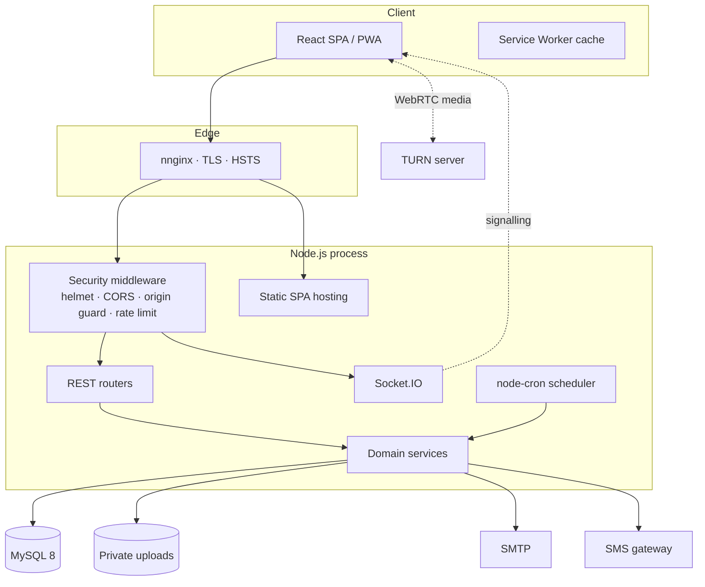
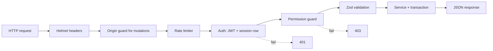
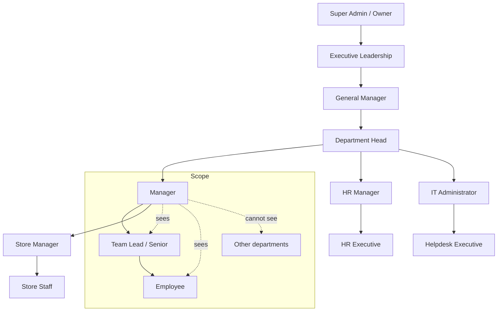
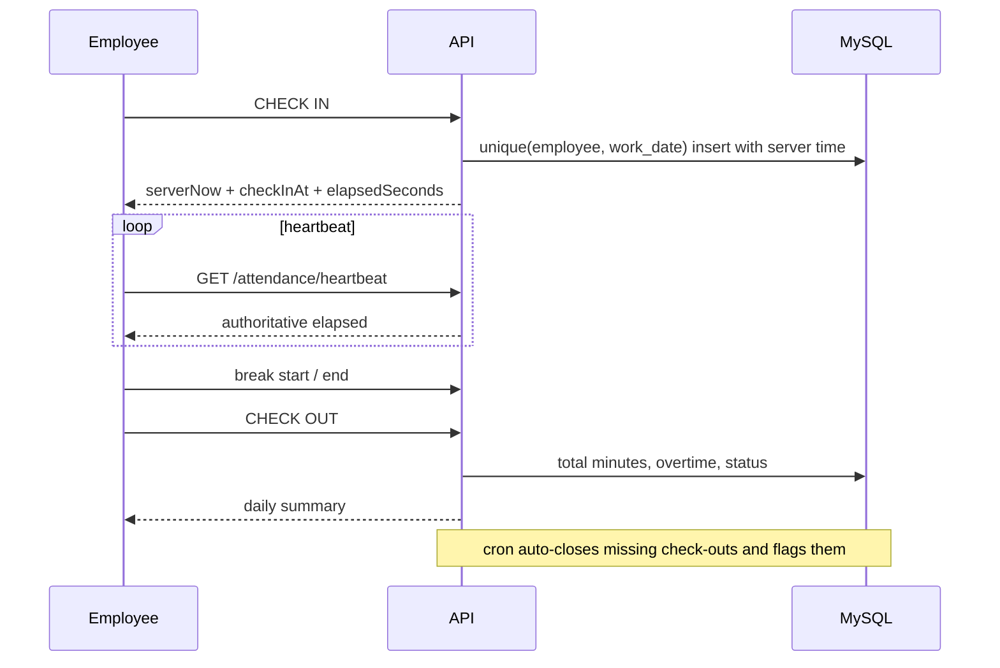
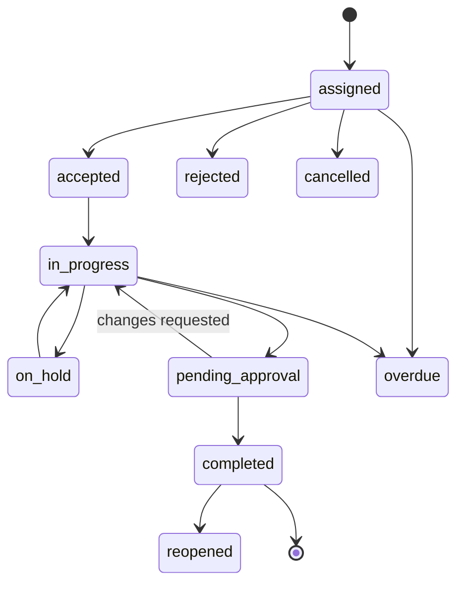
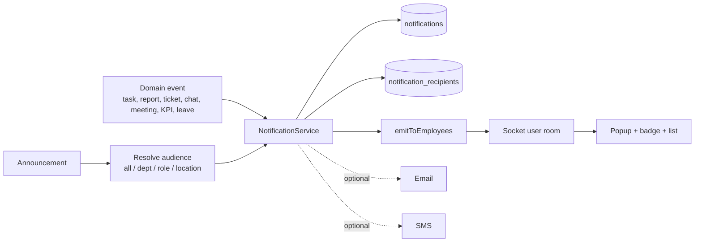
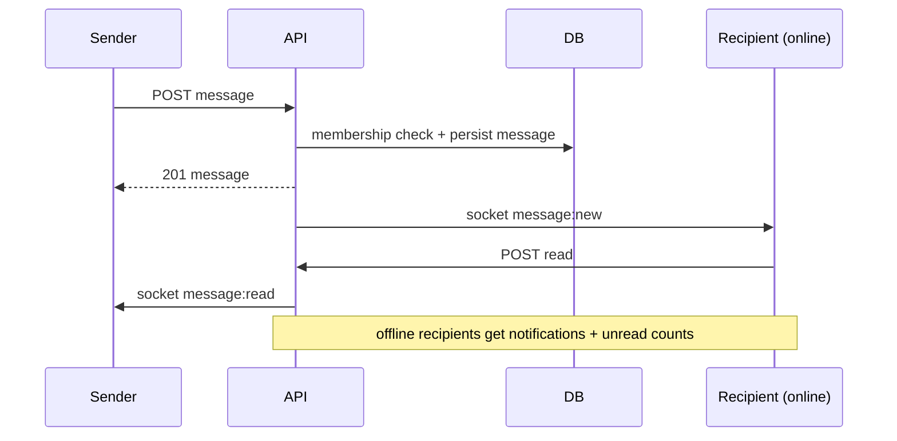
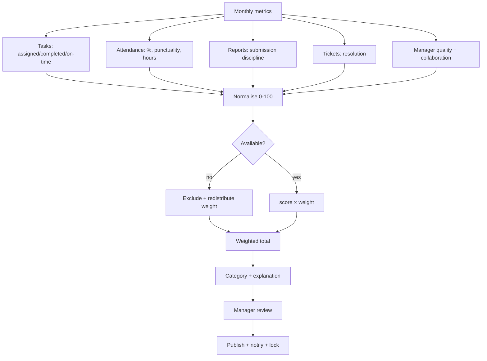
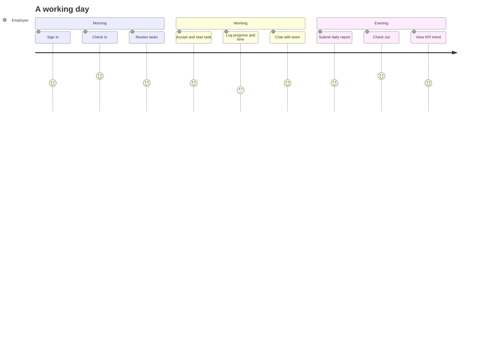
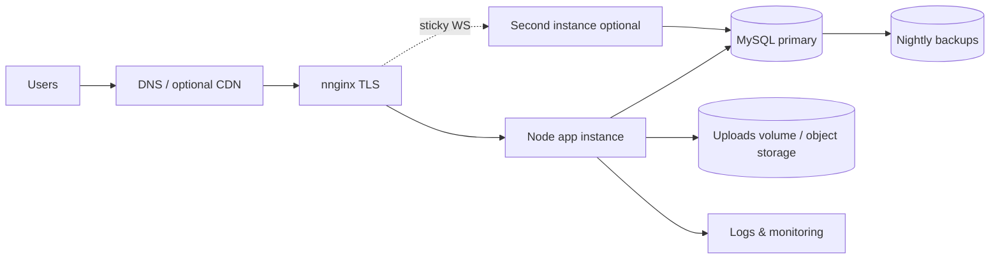

# DIAGRAMS.md — architecture and flow diagrams

All diagrams use Mermaid and render on GitHub, GitLab and most Markdown viewers.

## 1. System architecture

## 2. Request pipeline

## 3. Organisation hierarchy

## 4. Attendance flow

## 5. Task lifecycle

## 6. Notification architecture

## 7. Chat real-time flow

## 8. KPI computation

## 9. User journey (employee day)

## 10. Deployment topology

