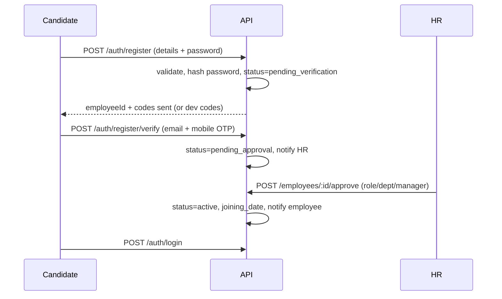
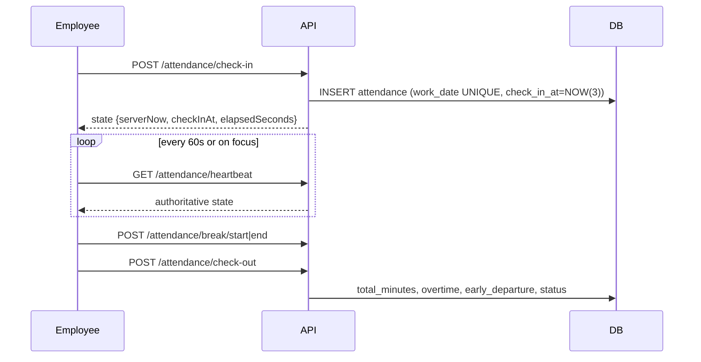
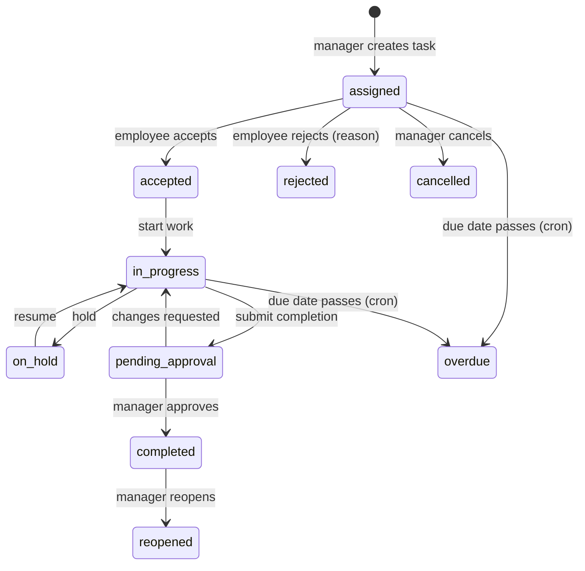
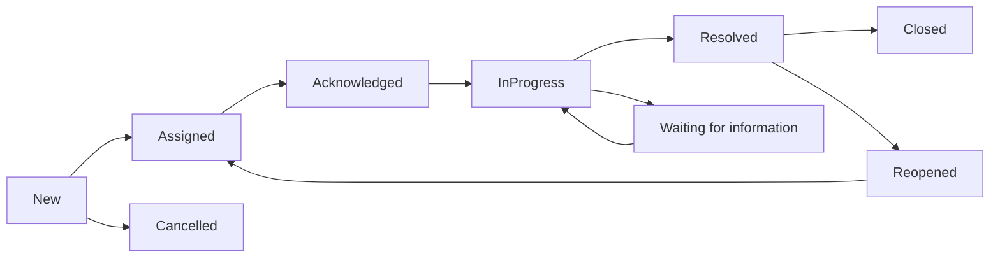
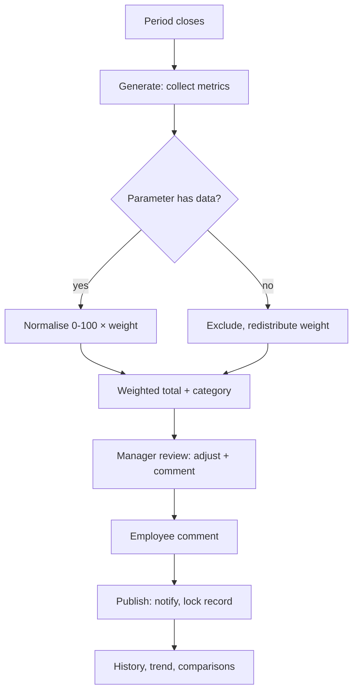

# Workflows

Each workflow lists actors, steps, guarantees and failure paths. All state changes are persisted and audited.

## 1. Employee registration

- Duplicate email/mobile/code rejected with 409.
- OTPs are hashed, expire, have resend cooldown and attempt caps.
- Pending accounts cannot log in.

## 2. Attendance

- The timer is derived from server timestamps, never the browser clock.
- A second check-in returns 409; a unique index enforces it even under races.
- Missing check-outs are auto-closed by cron after the configured grace and flagged.
- Corrections require a reason, manager approval, and create an audit entry with before/after.

## 3. Task allocation and follow-up

- Allocation validates the subtree for every assignee.
- Each transition checks the actor (assignee vs creator/manager) and the current status.
- Progress, time logs, comments, subtasks and checklist changes are stored with author and timestamp.
- Reminders at 24h/2h before due; overdue sweep hourly; recurring tasks spawn their next copy on completion.

## 4. Daily reporting

1. Employee opens **Daily Reports**; counts are pre-filled from live tasks and attendance (`/reports/suggestions`).
2. Submits summary (≥10 chars), problems, support needed, tomorrow's plan and attachments.
3. Unique `(employee_id, report_date)` prevents duplicates; managers are notified.
4. Manager approves or requests correction with a note; the employee is notified and the report stays permanently.
5. Managers compare allocated vs completed, estimated vs actual and pending work in team views and exports.

## 5. Ticket lifecycle

- Category determines the default team; priority determines the SLA window (from settings).
- SLA breach flags and escalates to the assignee's manager via cron.
- Internal notes are hidden from the requester.
- Resolution requires text; feedback (1–5 + comment) is captured from the requester.
- Reopen is allowed from resolved/closed and returns the ticket to the queue.

## 6. Communication

1. Sender posts a message; the server validates membership, stores the message and attachments, then emits `message:new` to `conv:{id}`.
2. Online members append instantly; others receive a notification and see an unread count.
3. Read events set receipts and notify the sender (`message:read`), producing the double tick.
4. Reactions/edit/delete emit deltas; deletion is soft and audited.
5. Typing and presence are ephemeral; last-seen is persisted on disconnect.
6. On reconnect the client refetches history and unread counts, so no update is lost.

## 7. Meetings

1. Organiser schedules (participants, agenda, time, room or online) → invitations + notifications.
2. Participants accept/decline; organiser sees responses.
3. At start time, **Join room** marks attendance, fetches ICE config, joins the Socket.IO meeting room. Peers exchange SDP/ICE via `meeting:signal`; media flows peer-to-peer (TURN when configured).
4. Chat, action items and outcome are stored with the meeting.
5. Reminders fire before the start; the meeting moves to completed after it ends.

## 8. KPI evaluation

- Weights are configurable and must total 100%.
- Scores are explainable per parameter (raw metric, normalised score, weight, contribution, note).
- Published records cannot be edited, preserving the audit trail.

## 9. Leave

1. Employee applies with type, dates, reason and optional document; overlap, balance and document rules are checked.
2. Manager approves → HR approves (or either rejects with a reason).
3. On approval, attendance is marked `on_leave` for the dates and balances are consumed; notifications are sent at each step.
4. Cancellation is allowed while pending.

## 10. Notifications

Any domain event calls `NotificationService.notify`, which inserts the notification and recipients, emits `notification:new`, and optionally sends email/SMS. Announcements resolve their audience server-side and fan out through the same path, so delivery is consistent and auditable.
